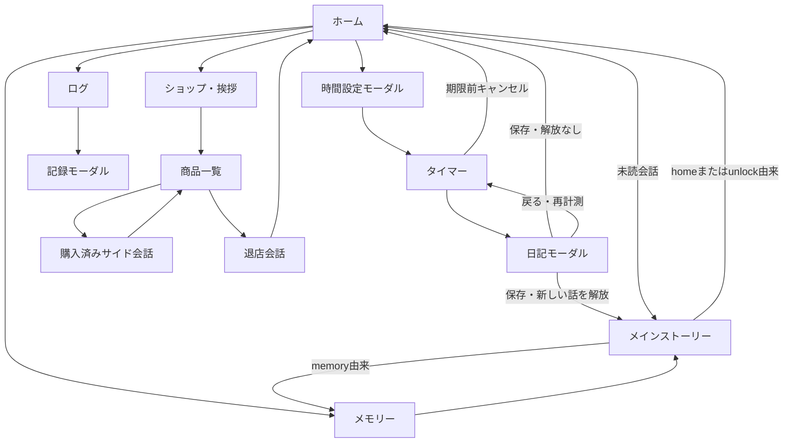

# 画面・機能仕様

この文書の「事実」はソース上の表示・処理条件。OSの戻る操作や実際のレイアウトは未検証。

2026-10-15更新: A03/A05のホーム日付更新・開始日ログ・日別合計・日記編集を反映。[検証記録](../manual-acceptance-checklist.md#date-record-alignment)。

## 共通表示

**事実**: 初期読込中は「My-Juneを準備しています…」。ストレージ読込例外時はエラー詳細と再読込ボタン。準備完了後、全ルートの上にNT残高、下にロゴとMy-Juneを表示し、Router標準ヘッダーは非表示。ユーザー名は表示しない。タイマーの黒画面モーダルは共通ヘッダー・フッターも覆う。根拠: [レイアウト](../../app/_layout.tsx)、[タイマー](../../app/timer.tsx)。

**事実**: `app.json`は縦向き、iPad対応、外観automatic。ただし画面色は固定の`Colors`で、ダークモード用の切替処理はない。根拠: [設定](../../app.json)、[テーマ](../../src/constants/theme.ts)。

## 画面一覧

| ルート | 表示と条件 | 操作・遷移 | 根拠 |
| --- | --- | --- | --- |
| `/` ホーム | タスク名、当日完了、累計完了、メイン解放数、NT。未読があれば会話吹出し。進行中タイマーがあれば再開バナー | タスク編集、時間設定、再開→`/timer`、未読→`/story?episode=…&source=home`、メモリー、ログ、ショップ | [ホーム](../../app/index.tsx)、[会話カード](../../src/components/home/HomeStoryCard.tsx) |
| `/timer` | 開始時のタスク名、残りHH:MM:SS。予定到達後は+HH:MM:SS、終了可能、獲得予定NT | 期限前のみキャンセル確認。期限後に日記を開く。黒画面を開く。セッションなしならホームへreplace | [画面](../../app/timer.tsx)、[フック](../../src/hooks/useTimerLogic.ts) |
| `/story` | `episode`に実在し解放済みのIDが必要。タイトル、ジェム/アルタ、セリフ、選択肢。直接`route`指定時は実在かつ解放済みが必要 | タップで文字送り/次の行/読了。第1話に分岐。途中閉じる。メモリー由来ならメモリー、home/unlockならホームへ戻る | [画面](../../app/story.tsx)、[読取フック](../../src/hooks/useStoryReader.ts) |
| `/memory` | 全3話のカード。解放済みはタイトル・解放日・再生。未解放はタイトルを隠し「タスク完了で解放」、操作不可 | 再生→`/story?episode=…&source=memory`。戻る→ホーム。全話解放時にバナー | [メモリー](../../app/memory.tsx) |
| `/log` | カレンダー。記録のある日に☆、選択日に背景色。データは`diaryLogs`を日付でグループ化 | 任意の日付を押す→記録モーダル。戻る→ホーム | [ログ](../../app/log.tsx)、[カレンダー](../../src/components/log/CustomCalendar.tsx) |
| `/shop` | greeting→list→farewell→closedの4段階。店員エトは仮アイコン。入荷済みの会話カードのみ表示 | 挨拶完了→一覧。未購入は確認後60 NTで購入、購入済みは`/side-story`。戻る操作は退店会話を経由してホーム | [ショップ](../../app/shop.tsx)、[商品](../../src/content/shop.ts) |
| `/side-story` | `conversation`指定で商品IDを選ぶ。省略時は101。購入済みのみ再生、ジェム/アルタの会話 | 文字送り・次の行・終了。途中閉じる/読了ともショップへ戻る。メイン既読には影響しない | [サイド会話](../../app/side-story.tsx)、[読取フック](../../src/hooks/useStoryReader.ts) |

### ホームの補足

**事実**: 未読のうち配列末尾に近い話を会話入口にする。読了すると次の未読が入口になる。全既読の場合、ホームに再生ボタンは出ずメモリーから読む。根拠: [getLatestUnreadEpisode](../../src/domain/storyData.ts)、[HomeStoryCard](../../src/components/home/HomeStoryCard.tsx)。

**事実**: 当日完了後もタイマー開始を制限しない。タスク名編集後も累計や当日完了状態は引き継ぐ。進行中セッションのタスク名は開始時の値を保持する。根拠: [ホーム](../../app/index.tsx)、[Provider](../../src/state/AppStateProvider.tsx)。

**事実**: 未解放あり・本日初回前なら「今日の初回完了でN話目」、本日完了後なら「今日は解放済みです。明日の初回完了で次の会話を解放できます」、全話解放後は「すべて解放済み」。話数は現行カタログ3話を参照する。0時・active復帰・30秒の時計再確認で当日表示を更新する。根拠: [ホーム](../../app/index.tsx)、[useLocalToday](../../src/hooks/useLocalToday.ts)。

### ストーリーの補足

**事実**: `source=memory`なら再生中の選択地点で全分岐を提示し、無料選択済み・購入済み以外に鍵と60 NTを表示する。home/unlockでは保存済み初回分岐を自動再生し、未選択なら初回選択する。`source`が不明/省略ならunlockとして扱う。根拠: [ストーリー画面](../../app/story.tsx)。

**事実**: 最終行が全文表示された後のタップで既読保存を行う。途中の「閉じる」は既読保存しない。再生位置は保存せず、開き直すと最初から。根拠: [読取フック](../../src/hooks/useStoryReader.ts)。

**事実**: 不正ID、未解放メイン、未購入サイド、未購入分岐の直接指定は「このストーリーはまだ読めません」を表示する。画面パラメーターのみで購入・解放はできない。根拠: [メイン](../../app/story.tsx)、[サイド](../../app/side-story.tsx)。

### ショップの補足

**事実**: 挨拶開始時に、入荷済みかつ未告知のIDを一度取得する。挨拶を最後まで進めた時に告知済み保存し、商品一覧へ進む。告知保存が失敗すると会話上にエラーを出して留まる。商品101は条件なし、102/103はメイン第2話の既読が条件。購入済みなら条件に関係なく表示する。根拠: [ショップ](../../app/shop.tsx)、[listAvailableConversations](../../src/domain/sideStory.ts)。

**事実**: NT不足の未購入商品と購入処理中のカードは無効。購入成功後も一覧に留まり、ユーザーが改めて再生を押す。画面削除を`usePreventRemove`で制御し、退店中の再度の戻るはclosedへ進める。根拠: [ショップ](../../app/shop.tsx)。

## モーダル・画面内パネル

| UI | 条件・入力 | 保存/閉じる/エラー | 根拠 |
| --- | --- | --- | --- |
| タスク名 | 初回は空なら強制表示。編集時は現在値を再設定。最大80文字 | 空白だけは拒否、前後空白除去。初回はキャンセル不可。保存失敗はモーダル内表示 | [TaskNameModal](../../src/components/home/TaskNameModal.tsx)、[setTaskName](../../src/state/AppStateProvider.tsx) |
| 時間設定 | 開くたび25分に戻す。±5分/±1時間、0〜1435分。既存セッションがあれば調整UIを出さず再開案内 | 開始は保存成功後に画面遷移。保存失敗はモーダル内表示。開始中は開始・閉じるボタンを無効化 | [TimerSetupModal](../../src/components/home/TimerSetupModal.tsx)、[設定フック](../../src/hooks/useTimerSetup.ts) |
| キャンセル確認 | 予定時間前にキャンセルを押す | 続ける/キャンセルする。確定時に時間条件を再判定。報酬もログも残さない | [タイマーフック](../../src/hooks/useTimerLogic.ts)、[cancelTimer](../../src/domain/completion.ts) |
| 日記 | 予定終了後の「終了して記録」。任意、最大1000文字、複数行 | 開く時に計測停止。保存して終了、または戻って計測再開。保存失敗時は日記上にエラー。下書きは閉じても同じ画面内なら保持 | [DiaryModal](../../src/components/timer/DiaryModal.tsx)、[フック](../../src/hooks/useTimerLogic.ts) |
| 省電力黒画面 | タイマー画面の省電力ボタン | 標準fullScreen Modal。ステータスバー非表示、タップ/戻る/アクセシビリティ脱出で復帰。実際の輝度・自動ロックは制御しない | [タイマー](../../app/timer.tsx) |
| ログ記録 | カレンダーの日付を押す。開始日の所属で集計 | 選択日の合計、各記録の開始時刻HH:MM:SS（旧記録は「記録なし」）・集中時間・日記。集中時間と合計は時分秒。開始日は個別表示しない。空日記は「振り返りなし」、空日は「記録なし」・合計0秒。前日/翌日へ移動、閉じる | [LogModal](../../src/components/log/LogModal.tsx) |
| 保存済み日記の編集 | 記録の「日記を編集する」。最大1000文字・空可 | 保存成功で反映、キャンセルで破棄。失敗は元の日記と下書きを保持してエラー・再試行。編集中は日付移動と閉じる操作を無効、OS戻るは編集キャンセル。保存中は入力・連打・キャンセルを抑止。時間/報酬/解放は不変 | [LogModal](../../src/components/log/LogModal.tsx)、[editDiary](../../src/domain/diary.ts) |
| 分岐解放確認 | メモリーで未解放分岐を押す。画面内パネルでありModalではない | 必要NTと残高。十分なら解放、足りなければ戻るのみ。成功後は選択肢一覧へ戻り、再度選んで再生 | [ストーリー](../../app/story.tsx)、[確認パネル](../../src/components/story/StoryUnlockConfirmation.tsx) |
| 商品購入確認 | 未購入かつ残高が十分な商品を押す | Alertでキャンセル/解放。失敗はAlert。価格60 NT | [ショップ](../../app/shop.tsx) |

**要確認**: モーダル表示中のOS戻る、ショップのジェスチャー・履歴、タイマー停止とBGM、WebのAlertと自動再生。静的な分岐条件だけではプラットフォーム差を確定できない。

## 主要遷移

根拠: [ホーム](../../app/index.tsx)、[タイマーフック](../../src/hooks/useTimerLogic.ts)、[読取フック](../../src/hooks/useStoryReader.ts)、[ショップ](../../app/shop.tsx)。図は主要なアプリ内操作を表し、OSの履歴操作を網羅しない。
